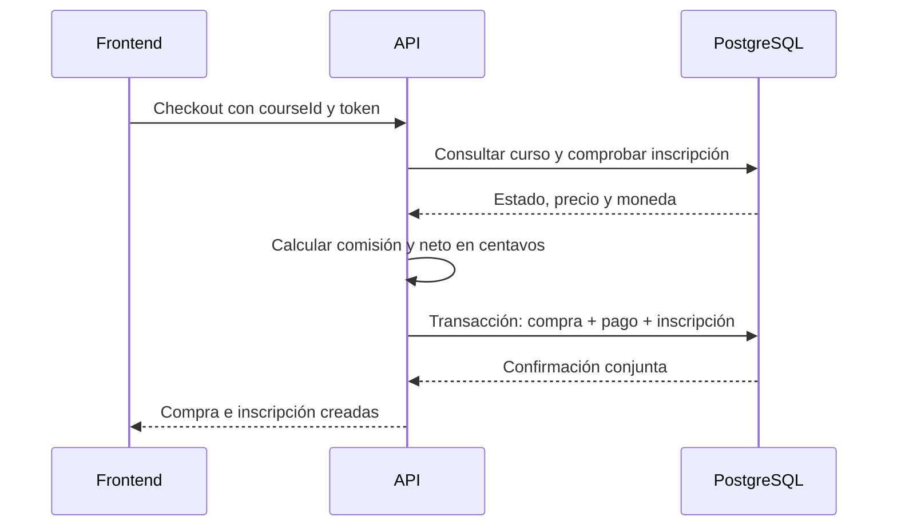

# Guía del backend de NeuroTalento

## 1. Qué se implementó

El backend es el programa que recibe las solicitudes de la interfaz, verifica quién puede hacer cada acción y guarda la información en PostgreSQL. El frontend debe consumir esta API para mostrar y modificar los datos.

La implementación usa JavaScript con módulos ES, Node.js, Express y Prisma 6.19.0. PostgreSQL está alojado en Neon. No necesita una base de datos en Docker.

| Función | Comportamiento implementado |
| --- | --- |
| Cuentas | Registro, login y consulta del usuario autenticado |
| Roles | `STUDENT` para aprender y `CREATOR` para publicar; el perfil no permite cambiar el rol |
| Perfiles | Nombre, preferencias del estudiante y biografía, especialidades y avatar del creador |
| Catálogo | Cursos publicados, filtros por categoría/creador y búsqueda por título o descripción |
| Cursos | Crear, editar, publicar y archivar; solo el propietario modifica su contenido |
| Contenido | Módulos y lecciones con posición, descripción y URL de video |
| Acceso | Videos privados disponibles para el propietario y los inscritos; vistas previas públicas |
| Inscripciones | Inscripción directa gratuita o inscripción incluida en el checkout |
| Aprendizaje | Marcar/desmarcar lecciones y calcular progreso y finalización |
| Compras | Compra y pago simulados, con precio obtenido de la base de datos |
| Comisión | Porcentaje configurable, inicialmente 15%, calculado en centavos enteros |
| Opiniones | Una calificación por estudiante inscrito y curso |
| Dashboards | Progreso del estudiante; cursos, estudiantes, ventas y ganancias del creador |
| Operación | Health de PostgreSQL, validaciones, errores centralizados y cierre del servidor |

Los pagos son simulados: no se cobra dinero, no se solicitan tarjetas y no se transfiere dinero al creador. Las ganancias son registros de demostración.

## 2. Flujos del producto

### Un creador publica un curso

1. Se registra con rol `CREATOR` y obtiene un token JWT.
2. Consulta las categorías y crea un curso con su precio en centavos.
3. Agrega módulos y lecciones; cada posición debe ser única dentro de su padre.
4. Publica el curso. Debe existir al menos un módulo y cada módulo debe tener lecciones.
5. El curso aparece en el catálogo público.
6. Consulta sus ventas y ganancias en su dashboard.

Los cursos nacen en `DRAFT`. Publicarlos cambia su estado a `PUBLISHED`. Eliminar un curso por la API cambia su estado a `ARCHIVED`: conserva sus compras e inscripciones. Los inscritos mantienen el acceso al contenido archivado. El propietario puede volver a publicar un curso archivado si cumple las condiciones de publicación.

### Un estudiante aprende

1. Se registra con rol `STUDENT` e inicia sesión.
2. Busca un curso publicado y consulta su detalle.
3. Se inscribe directamente si es gratuito o utiliza checkout.
4. Accede al contenido completo de su inscripción.
5. Marca lecciones como completadas. Al completar todas, la inscripción pasa a `COMPLETED`.
6. Puede dejar una opinión y consultar su progreso.

Desmarcar una lección reabre la inscripción. Agregar una lección a un curso también reabre las inscripciones completadas. Los cursos sin lecciones completadas aún no se cuentan como cursos en progreso en el dashboard.

### Una compra simulada



Una transacción hace que las escrituras se confirmen juntas o se deshagan juntas si fallan. El aislamiento `Serializable` y las restricciones únicas protegen frente a operaciones concurrentes. Si existe un conflicto, la API devuelve 409; no implementa reintentos automáticos.

El checkout registra compra y pago incluso con precio cero. La inscripción gratuita directa solo crea la inscripción. No se aceptan importes enviados por el frontend.

## 3. Arquitectura y archivos

```text
backend/
├── prisma/
│   ├── schema.prisma       Modelo de las 12 entidades
│   ├── migrations/         Migración SQL inicial y restricciones
│   └── seed.js             Categorías iniciales sin usuarios personales
├── scripts/                Diagnóstico, migración auxiliar y prueba real
├── src/
│   ├── config/             Carga de entorno y cliente Prisma
│   ├── middleware/         JWT, roles, validación y errores
│   ├── routes/             URLs, métodos HTTP y permisos
│   ├── controllers/        Adaptación de solicitudes y respuestas
│   ├── services/           Reglas de negocio y acceso a datos
│   ├── utils/              Errores de aplicación y cálculo monetario
│   ├── app.js              Configuración de Express y montaje de rutas
│   └── server.js           Arranque y cierre del servidor
├── test/backend.test.js    Pruebas con base simulada
├── .env.example            Variables de ejemplo sin credenciales reales
├── package.json            Dependencias y comandos
└── package-lock.json       Versiones resueltas de dependencias
```

Una petición sigue este recorrido: **ruta → autenticación/validación → controlador → servicio → Prisma → PostgreSQL**. Los errores llegan al middleware central. Algunas rutas pequeñas usan el adaptador compartido `controllers/http.js` sin necesitar un controlador específico.

| Archivo o grupo | Responsabilidad |
| --- | --- |
| `config/env.js` | Lee `backend/.env`, valida secreto, puerto y comisión; las variables del proceso tienen prioridad |
| `config/database.js` | Crea el cliente Prisma compartido |
| `middleware/auth.js` | Verifica JWT, recupera el usuario actual y comprueba roles |
| `middleware/validation.js` | Valida campos y produce datos filtrados para los servicios |
| `middleware/errors.js` | Convierte errores de negocio y de Prisma en respuestas HTTP |
| `auth.service.js` | Registro, hashing y verificación de contraseñas, emisión de tokens |
| `users.service.js` | Perfiles y ficha pública de creadores |
| `courses.service.js` | Catálogo, propiedad, publicación, archivo y contenido |
| `payments.service.js` | Checkout transaccional, historial y ganancias por moneda |
| `enrollments.service.js` | Acceso a inscripciones y actualización transaccional del progreso |
| `reviews.service.js` | Opiniones e inscripción necesaria para publicar una |
| `dashboard.service.js` | Estadísticas de estudiantes y creadores |
| `utils/money.js` | Reparto de importe mediante enteros y `BigInt` |
| `scripts/check-db.js` | Consulta `SELECT 1` con límite de diez segundos y salida sin credenciales |
| `scripts/inspect-db.js` | Muestra si la conexión es pooled/Neon y los nombres de tablas públicas |
| `scripts/neon-migrate.js` | Ejecuta migraciones; si hace falta, deriva la URL directa de Neon en memoria |
| `scripts/smoke.js` | Arranca `server.js`, prueba un flujo real y limpia sus datos temporales |

## 4. Dependencias y su propósito

| Dependencia | Uso |
| --- | --- |
| `express` | Servidor HTTP y rutas REST |
| `@prisma/client` y CLI `prisma` 6.19.0 | Consultas, esquema y migraciones de PostgreSQL |
| `bcrypt` | Hash de contraseñas con costo 12 |
| `jsonwebtoken` | Tokens JWT firmados con HS256 |
| `express-validator` | Comprobación y selección de entradas |
| `dotenv` | Lectura del archivo de entorno |
| `cors` | Configuración del origen del frontend en el navegador |
| `nodemon` | Reinicio del servidor al editar código durante desarrollo |
| `node:test` y `node:assert` | Pruebas; vienen incluidos con Node.js |

## 5. Instalación y configuración

Desde la raíz del repositorio, en PowerShell, con Node.js 22 y npm instalados:

```powershell
cd backend
npm ci
if (-not (Test-Path .env)) { Copy-Item .env.example .env }
node -e "console.log(require('node:crypto').randomBytes(48).toString('hex'))"
```

Guarda el secreto generado en `JWT_SECRET` dentro de tu `.env`. No compartas el valor. Conserva el mismo secreto entre reinicios para que los tokens sigan siendo válidos hasta su vencimiento; cambiarlo invalida los tokens anteriores.

En Neon, copia la conexión pooled a `DATABASE_URL` y la directa a `DIRECT_URL`. Las variables y sus valores de ejemplo están en [`.env.example`](../backend/.env.example); ninguna credencial real debe aparecer en documentación o commits.

| Variable | Configuración |
| --- | --- |
| `DATABASE_URL` | URL pooled para consultas normales, con SSL |
| `DIRECT_URL` | URL directa para migraciones, con SSL |
| `JWT_SECRET` | Mínimo 32 caracteres y distinto del texto de ejemplo |
| `JWT_EXPIRES_IN` | Duración del token, predeterminada `7d` |
| `PLATFORM_COMMISSION_PERCENT` | De 0 a 100, hasta dos decimales, predeterminado `15` |
| `PORT` | Entero de 1 a 65535, predeterminado `3000` |
| `FRONTEND_URL` | Origen exacto del frontend, predeterminado `http://localhost:5173` |
| `NODE_ENV` | Etiqueta del entorno; el código actual no cambia su lógica por esta variable |

```powershell
npm run db:generate
npm run db:validate
npm run db:deploy
npm run db:seed
npm run db:check
npm run dev
```

Comprueba `http://localhost:3000/api/health`. Con PostgreSQL disponible devuelve HTTP 200 y `database: "connected"`; si no responde devuelve 503. El servidor puede arrancar aunque la base no esté disponible: health comprueba la conexión al recibir la solicitud.

Si solo está configurada la conexión pooled de Neon, `npm run db:deploy:neon` deriva la conexión directa en memoria sin cambiar `.env`. Para los comandos estándar configura `DIRECT_URL` explícitamente.

## 6. Comandos de mantenimiento

Todos se ejecutan desde `backend/`.

| Comando | Cuándo usarlo |
| --- | --- |
| `npm run dev` | Desarrollo con reinicio automático |
| `npm start` | Arranque sin nodemon |
| `npm run db:generate` | Regenerar el cliente tras cambiar el esquema |
| `npm run db:validate` | Validar el esquema; no comprueba una conexión real |
| `npm run db:migrate -- --name descripcion` | Crear/aplicar migraciones de desarrollo; puede requerir base shadow |
| `npm run db:deploy` | Aplicar migraciones SQL incluidas sin crear nuevas |
| `npm run db:deploy:neon` | Aplicar migraciones con el auxiliar de conexión directa de Neon |
| `npm run db:seed` | Insertar las siete categorías que no existan |
| `npm run db:studio` | Inspeccionar y editar registros mediante Prisma Studio |
| `npm run db:check` | Comprobar conexión real a PostgreSQL |
| `npm test` | Pruebas con base simulada y HTTP local |
| `npm run test:live` | Flujo completo contra la base configurada |

Los cambios del esquema deben acompañarse de una migración revisada. Usa migraciones SQL para conservar los CHECK de importes y calificaciones; `db push` no reproduce esas restricciones personalizadas. No uses `migrate reset` sobre datos que quieras conservar.

Al recibir SIGINT/SIGTERM, `server.js` deja de aceptar conexiones y desconecta Prisma. Tiene un límite de diez segundos para terminar. El manejo de señales depende del sistema operativo.

## 7. Seguridad y límites del alcance

El token identifica al usuario, pero la API consulta la cuenta en cada petición privada y verifica el rol actual. Además del rol, las modificaciones de contenido comprueban quién es el propietario. Las contraseñas se guardan como hash y no se devuelven en las respuestas. No se definen campos médicos ni se exige un diagnóstico.

Las contraseñas requieren mínimo diez caracteres y máximo 72 bytes UTF-8. El JSON de entrada tiene un límite de 100 KB. Las rutas de escritura rechazan campos no permitidos, incluido un intento de cambiar `role`, `creatorId` o el precio del checkout. CORS está configurado para el origen indicado; los permisos se aplican con JWT y reglas del servidor.

El alcance actual no incluye recuperación de contraseña, verificación de correo, refresh tokens, revocación de tokens, rol administrador, pagos reales, reembolsos, retiros del creador, carga de archivos, almacenamiento de videos ni URLs firmadas. `videoUrl` referencia un recurso externo; ocultarlo en la respuesta pública no impide que alguien comparta una URL ya conocida. No existe limitación de intentos de login en esta implementación.

La API no expone CRUD público de categorías: se inicializan mediante seed. No hay consulta de curso por slug: la ruta de detalle utiliza UUID. Los listados paginados devuelven un arreglo, sin total de páginas. Las cuentas tienen un solo rol y no pueden cambiarlo por perfil.

## 8. Pruebas y evidencia

Estos son resultados de la implementación realizada en esta conversación, no una garantía de que la conexión o las dependencias mantengan el mismo estado en otro entorno.

| Verificación realizada | Resultado registrado |
| --- | --- |
| Instalación de dependencias | Completada; lockfile generado |
| Esquema Prisma | Validación correcta y cliente 6.19.0 generado |
| Sintaxis JavaScript | 31 archivos revisados; última edición del script smoke también verificada |
| `npm test` | Cinco pruebas aprobadas con base simulada |
| Conexión Neon | `SELECT 1` respondió correctamente |
| Migración | Base inicialmente vacía inspeccionada; migración inicial aplicada por conexión directa |
| Seed | Siete categorías inicializadas |
| `npm run test:live` | Arranque de `server.js` y flujo HTTP real aprobados |
| Limpieza de la prueba real | Datos temporales eliminados |

Las pruebas simuladas cubren comisiones, condiciones de checkout, propiedad, publicación, protección de videos, progreso, registro, login, JWT, roles, validación y health disponible/no disponible. No equivalen a probar la ejecución SQL de una transacción.

La prueba real verifica health, cuentas, propiedad, creación/publicación de contenido, checkout, inscripción, progreso, opiniones y dashboards sobre PostgreSQL. Comprobó que 1999 centavos generan 300 de comisión y 1699 para el creador. No mide rendimiento ni prueba exhaustivamente concurrencia, todos los fallos posibles o todos los endpoints de edición.

`test:live` escribe datos: crea cuentas con identificadores aleatorios y los elimina junto con su curso, compra y progreso en un bloque de limpieza. Si se interrumpe el proceso o falla la base durante esa limpieza, pueden quedar registros temporales. Utiliza una base o rama de desarrollo del proyecto.

## 9. Pendientes conocidos

Al terminar la implementación se conservó intacto el `.env` existente. Contenía la URL pooled; faltaba configurar un `JWT_SECRET` permanente y guardar `DIRECT_URL` para los comandos estándar. La prueba real usó un secreto temporal y la migración auxiliar derivó la URL directa en memoria. Esto describe el estado observado entonces; no vuelve a leer ni publica los secretos actuales.

La auditoría de dependencias reportó seis avisos: cuatro altos en Prisma/config y sus dependencias `effect`/`deepmerge-ts`, y dos moderados en nodemon/minimatch. Con `--omit=dev` seguían apareciendo los cuatro de Prisma. No se aplicó la actualización forzada a Prisma 7 porque la tarea exige Prisma 6. Queda pendiente revisar una solución compatible; vuelve a consultar `npm audit` al actualizar dependencias.

El frontend no se implementó ni modificó como parte de este trabajo. La integración debe seguir [la referencia de la API](backend-api.md).

## 10. Problemas comunes

| Síntoma | Qué revisar |
| --- | --- |
| Error al iniciar por `JWT_SECRET` | Secreto ausente, menor de 32 caracteres o todavía con el texto de ejemplo |
| Health devuelve 503 | Conexión, SSL, red y disponibilidad de Neon; ejecutar `db:check` |
| Prisma pide `DIRECT_URL` | Agregar la conexión directa o usar `db:deploy:neon` para aplicar migraciones |
| `EADDRINUSE` | Puerto ocupado; detener el otro proceso o cambiar `PORT` |
| Frontend bloqueado por CORS | `FRONTEND_URL` debe coincidir con protocolo, host y puerto de la interfaz |
| HTTP 401 | Falta token, está mal formado, venció o cambió el secreto |
| HTTP 403 | Rol incorrecto o recurso de otro usuario |
| HTTP 402 al inscribirse | Curso de pago: utilizar checkout |
| HTTP 409 | Registro duplicado, posición ocupada, dependencia o conflicto concurrente |
| HTTP 422 al publicar | Curso sin módulos o algún módulo sin lecciones |
| Video ausente en detalle | La lección no es preview y la petición no tiene un usuario con acceso |

## 11. Glosario breve

| Término | Significado en este proyecto |
| --- | --- |
| API REST / endpoint | Dirección y método HTTP que el frontend llama para una acción |
| JWT / Bearer | Token enviado en el encabezado Authorization para identificar la cuenta |
| Hash | Representación de una contraseña para verificarla sin guardar el texto original |
| ORM / Prisma | Herramienta que conecta el código con las tablas y consultas |
| Migración | Archivo SQL versionado que cambia la estructura de la base |
| Seed | Script que inserta datos iniciales faltantes |
| UUID | Identificador de un registro |
| Pooled / directa | Conexión compartida para consultas / conexión usada para migraciones |
| Idempotente | Operación repetible sin duplicar los datos iniciales; así funciona el seed |

Consulta también el [modelo de datos](database.md) y la [referencia de endpoints](backend-api.md).
